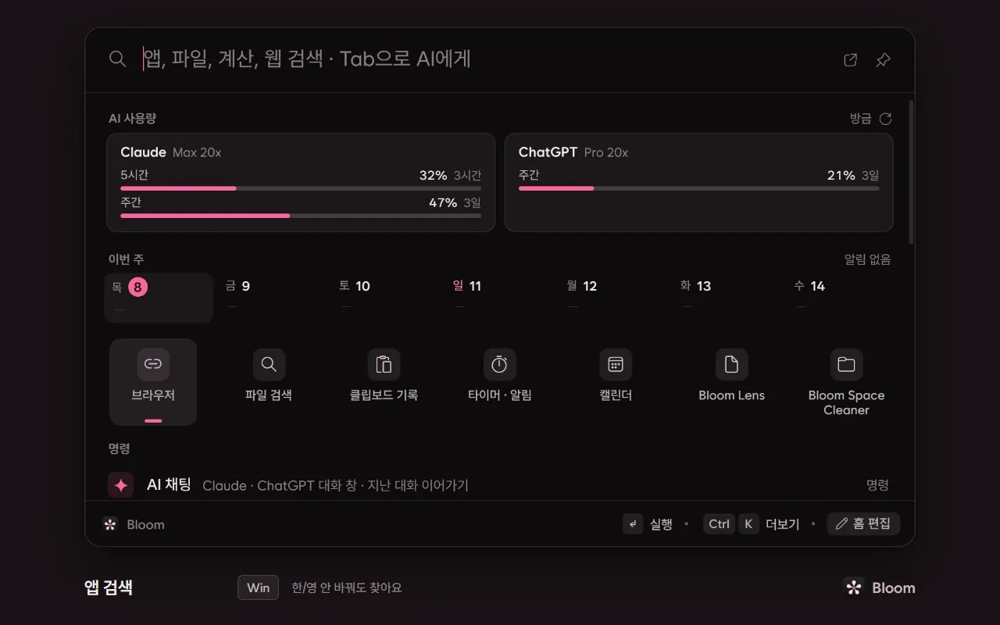
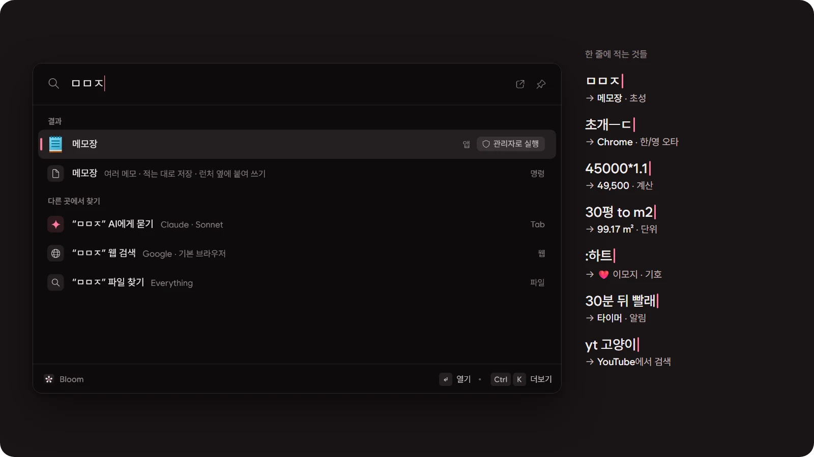
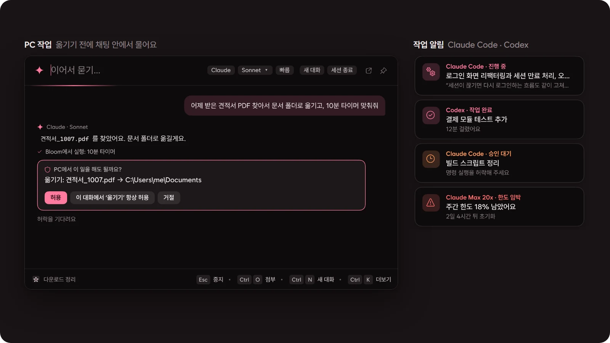
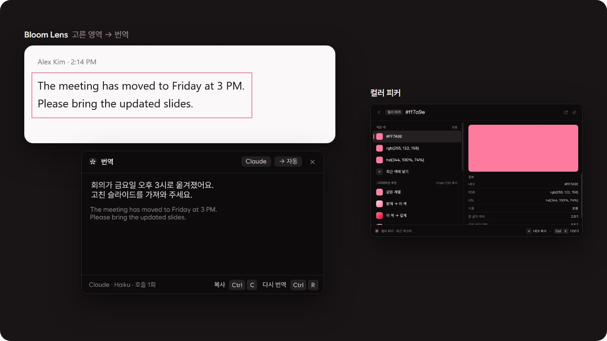
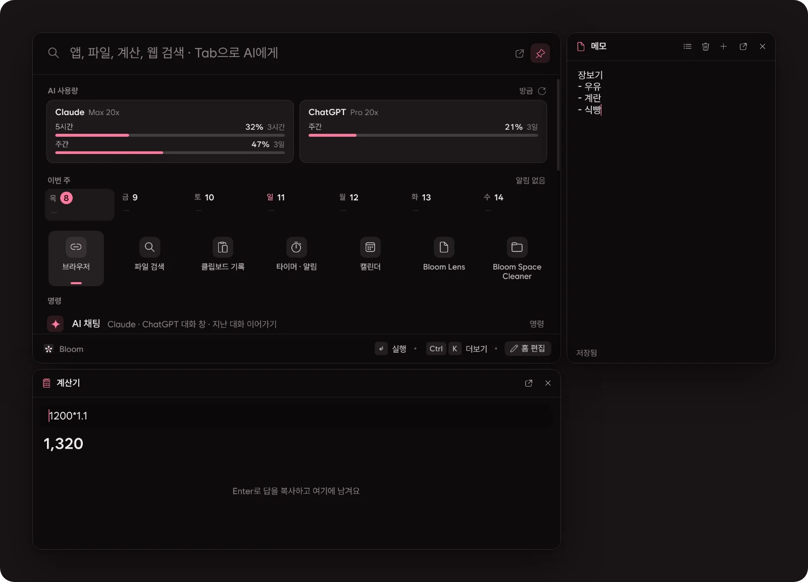
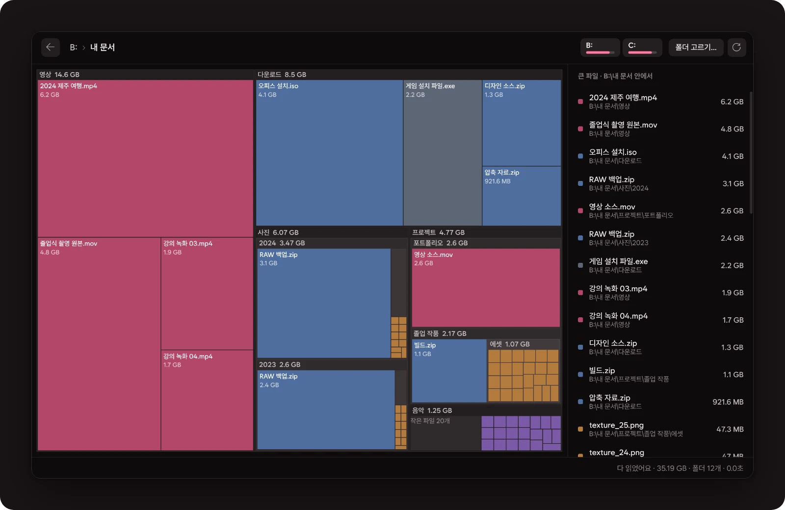
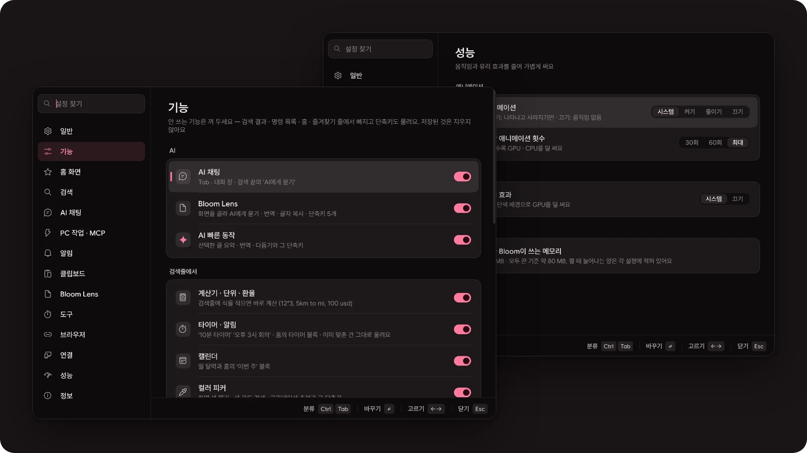

<p align="center"></p>

<h1 align="center">Bloom</h1>

<p align="center"><b>Win 키 한 번, 한 줄이면 끝.</b><br>
Windows용 가벼운 네이티브 런처예요. 앱 실행부터 계산, 파일, AI 채팅, 화면 번역까지 검색창 하나에서 해요.</p>

<p align="center">
  <a href="#설치--빌드">설치</a> · <a href="#기능">기능</a> · <a href="#단축키">단축키</a> · <a href="#ai-기능에-대해">AI와 개인정보</a> · <a href="README.md">English</a>
</p>

<p align="center">
  
</p>

<p align="center"><sub>WPF · .NET 10 · WebView 없음 · NuGet 패키지 없음 · 모두 끈 상태 약 80 MB · 한국어 / English · MIT</sub></p>

## 기능

### 검색창 하나로



이름을 다 치지 않아도, 키보드가 한글에 놓여 있어도 찾아요. 식은 적는 동안 계산되고, 시간은 말하듯이 적으면 돼요.

- **앱 · 설정 · 명령**: 시작 메뉴 앱, Windows 설정 페이지, Bloom 명령. 초성(`ㅁㅁㅈ` → 메모장)과 한/영 오타(`초개ㅡㄷ` → chrome)도 알아들어요.
- **계산 · 단위 · 환율**: `45000*1.1`, `30평 to m2`, `100 usd`
- **타이머 · 알림 · 캘린더**: `10분 타이머`, `30분 뒤 빨래`, `오후 3시 반에 회의 알림`
- **웹 검색 · 사이트 바로 가기**: 적은 그대로 브라우저 검색으로(Google · 네이버 · Bing · DuckDuckGo), `yt 고양이`
- **파일 · 최근 파일 · 창 전환**: [Everything](https://www.voidtools.com/)이 있으면 파일 이름으로, 없으면 최근 파일에서 찾아요. 열린 창도 이름으로 찾아 바로 전환해요.
- **이모지 · 특수문자**: `:하트`, `arrow`, `섭씨`
- **시스템 토글**: 다크 모드, 소리 · 마이크 끄기, `볼륨 30`, 출력 장치, Wi-Fi · 블루투스, 숨김 파일, 절전 …
- 결과마다 **Ctrl+K**를 누르면 그 항목으로 할 수 있는 일이 다 나와요. 파일이면 이름 바꾸기 · 옮기기 · 복사 · 휴지통.
- 같은 글자를 치고 고른 항목은 다음부터 위로 올라와요.

### AI — 내 Claude Code · Codex 로그인 그대로



API 키는 필요 없어요. 이 PC에 설치하고 로그인해 둔 Claude Code나 Codex CLI가 답해요.

- **검색창에서 Tab**으로 바로 묻고, 따로 띄우는 **AI 채팅 창**(Ctrl+Alt+C)에서 지난 대화 · 그룹 · 파일 첨부를 다뤄요.
- **PC 작업**: "어제 받은 PDF 문서 폴더로 옮기고 10분 타이머 맞춰줘"처럼 말하면 해요. 무언가를 바꾸는 일은 매번 채팅 안에서 허락을 받아요.
- **AI 빠른 동작**(Ctrl+Alt+A): 선택한 글자를 요약 · 번역 · 맞춤법 · 다듬기 …
- **사용량**: 홈에 Claude · ChatGPT의 5시간 · 주간 한도를 쓴 만큼 또는 남은 만큼으로 보여 줘요.
- **작업 알림**: Claude Code · Codex가 일을 시작했을 때, 끝났을 때, 승인을 기다릴 때, 한도가 가까워지거나 다시 찼을 때 카드와 소리로 알려요.

### 화면에서 — Bloom Lens · 컬러 피커



- **Bloom Lens**(Ctrl+Alt+L): 화면 영역을 끌어서 고른 뒤 `1` AI에게 묻기 · `2` 번역 · `3` 글자 복사(Windows OCR) · `4` 실시간 번역.
- **컬러 피커**: 돋보기로 화면 색을 찍거나 색 코드를 붙여 넣으면 HEX · RGB · HSL과 그 색에서 만든 그라데이션(CSS 복사)을 보여 줘요.

### 옆에 붙는 도구



- **Ctrl+J**로 메모 · 타이머 · 계산기 · 클립보드를 작은 창으로 열어요. 런처 옆이나 아래에 붙이면 함께 보였다 숨고, 떼어 내면 따로 떠 있어요.
- **메모**는 적는 대로 저장돼요. 검색줄에 `메모 우유 사기`라고 쳐도 되고, 메모 내용도 검색돼요.
- **클립보드 기록**(Ctrl+Alt+V): 텍스트 · 이미지 · 파일.
- **고정 · 크기**: Ctrl+P로 런처를 화면에 남겨 두고, Ctrl+= / Ctrl+-로 80~150%.

### Bloom Space Cleaner



드라이브나 폴더의 용량을 지도로 보여 줘요. 블록을 눌러 안으로 들어가고, 큰 파일 목록에서 골라 휴지통으로 보내요. 드라이브 루트와 Windows 폴더는 건드리지 않아요.

### 내 방식대로



- **내 명령**: 스크립트(.ps1 · .bat · 프로그램 · PowerShell 한 줄), 스니펫, 묶음(`메모장 ; 볼륨 30 ; 기다리기 2초`)을 단축어로 실행해요. 단축어 뒤에 적은 말은 `{input}` 자리에 들어가요.
- **즐겨찾기**: 아이콘 줄(Ctrl+1…9)과 폴더. 원하면 AI가 그린 아이콘.
- **홈 화면**: 빈 검색창에 보일 블록과 순서를 골라요.
- **기능 켜고 끄기**: 안 쓰는 기능은 검색 결과 · 명령 목록 · 홈 · 단축키에서 빠져요. 저장된 것은 지우지 않아요.
- **성능 · 모양**: 애니메이션 켜기 · 줄이기 · 끄기, 초당 횟수, 유리 효과. 색 테마 프리셋, 다크/라이트.

<details>
<summary><b>기능 전체 목록</b></summary>

- **앱 · 명령 검색**: 시작 메뉴 앱, Windows 설정 페이지, Bloom 명령을 찾아요. 초성(ㅁㅁㅈ → 메모장)과 한/영을 잘못 두고 친 글자(초개ㅡㄷ → chrome)도 알아들어요. 앱 이름을 Bloom 안에서만 바꿀 수 있어요.
- **즐겨찾기**: 아이콘 줄(Ctrl+1…9)과 폴더. 이름에 맞춘 그림 아이콘, 원하면 AI가 그린 아이콘.
- **계산기 · 웹 검색**: 식을 적으면 바로 계산, 그대로 브라우저로 검색을 넘겨요(Google · 네이버 · Bing · DuckDuckGo).
- **파일 찾기 · 정리**: [Everything](https://www.voidtools.com/)이 설치돼 있을 때, 영상/사진/문서/폴더 등 종류로 좁히기와 미리보기. 결과에서 Ctrl+K로 이름 바꾸기 · 다른 폴더로 옮기기/복사 · 휴지통으로 보내기(탐색기와 같은 방식이라 진행 창과 이름 충돌 질문도 그대로).
- **내 명령**: 자주 하는 일을 단축어로 실행해요. 스크립트(.ps1 · .bat · 프로그램, 또는 PowerShell 한 줄 — 창 없이 돌리고 결과는 알림 카드로), 스니펫(자주 쓰는 글을 앞의 창에 붙여넣기, `{date}` `{time}` `{clipboard}`), 묶음(`메모장 ; 볼륨 30 ; 기다리기 2초 ; yt lofi`처럼 검색창에 적을 줄을 차례로 실행). 단축어 뒤에 적은 말은 `{input}` 자리에 들어가요(`bk D:\사진`). 스크립트 파일은 Ctrl+K > 내 명령으로 등록.
- **클립보드 기록** (Ctrl+Alt+V): 텍스트 · 이미지 · 파일.
- **AI 채팅**: 설치된 Claude Code CLI 또는 Codex CLI로 대화(모델 · 생각 수준 선택). 검색창에서 Tab으로 바로 묻고(Shift+Tab은 새 대화), 따로 띄우는 **AI 채팅 창**(Ctrl+Alt+C)에서는 지난 대화 목록 · 이어하기 · 세션 종료 · 그룹(폴더, 끌어다 놓기). 파일 · 사진 첨부(끌어다 놓기, Ctrl+O, Ctrl+V), AI가 만든 파일 받기(열기 · 저장).
- **작업 알림**: Claude Code · Codex가 일을 시작했을 때, 끝났을 때, 승인을 기다릴 때, 사용량 한도가 가까워지거나 다시 찼을 때 화면 구석에 카드와 소리로 알려요. 위치 6곳 · 크기 · 소리 · 알릴 일을 고르고, 전체 화면 게임이나 발표 중에는 띄우지 않아요.
- **AI 사용량**: 홈 화면에 Claude · ChatGPT의 5시간 · 주간 사용량. 5분 또는 10분마다(↻로 바로) 각 CLI에 창 없이 물어보고 닫아요. 쓴 만큼 또는 남은 만큼으로 볼 수 있어요(설정 > 홈 화면).
- **Bloom Lens** (Ctrl+Alt+L): 화면 영역을 골라 AI에게 묻기 · 번역 · 글자 복사(Windows OCR) · 실시간 번역.
- **Bloom Space Cleaner**: 드라이브나 폴더의 용량을 지도로 보여 줘요. 블록을 눌러 안으로 들어가고, 큰 파일 목록에서 골라 휴지통으로 보내요(드라이브 루트 · Windows 폴더는 건드리지 않아요).
- **타이머 · 알림 · 캘린더**: 검색창에 `10분 타이머`, `30분 뒤 빨래`, `오후 3시 반에 회의 알림`처럼 적으면 돼요. 알림은 월간 달력과 홈의 '이번 주'에도 보여요.
- **컬러 피커**: 돋보기로 화면 색 찍기, HEX/RGB/HSL 복사, 그 색에서 만든 그라데이션 추천(CSS 복사).
- **브라우저**: 검색과 링크를 고른 브라우저로 넘기기, 사이트 바로 가기(단축어 + 검색어, 예: `yt 고양이`).
- **창 전환**: 열린 창을 이름으로 찾아 전환, Ctrl+W로 닫기. 루트 검색에도 몇 개 섞여 나와요(설정에서 끌 수 있어요).
- **입력어별 학습**: 같은 글자를 치고 고른 항목이 다음부터 위로 올라와요. 새로 고른 습관이 예전 것을 이기고, 설정에서 지울 수 있어요.
- **이모지 · 특수문자**: 한국어/영어 이름으로 찾아 붙여넣기(`하트`, `arrow`, `섭씨`). 루트에서 `:`로 시작해도 돼요.
- **시스템 토글**: 다크 모드, 소리/마이크 끄기, 볼륨(`볼륨 30`), 출력 장치, Wi-Fi · 블루투스, 숨김 파일 · 확장자, 절전, 화면 끄기, 휴지통 비우기.
- **최근 파일**: Windows의 최근 항목. Everything이 없을 때는 루트 검색에도 나와요.
- **AI 빠른 동작** (Ctrl+Alt+A): 선택한 글자(없으면 클립보드)를 요약 · 번역 · 맞춤법 · 다듬기 · 줄이기 · 늘이기 …, 또는 직접 적은 지시로 바꾸고 붙여넣기.
- **그 밖에**: 프로세스 종료, 화면 잠금 · 재시작 · 종료.
- **성능**: 애니메이션 켜기 · 줄이기 · 끄기, 초당 애니메이션 횟수(30 · 60 · 최대), 유리 효과 끄기. 메모리를 쓰는 기능은 설정에 늘어나는 양을 적어 뒀어요(모두 끈 상태 약 80 MB).
- **도구 창** (Ctrl+J): 메모 · 타이머 · 계산기 · 클립보드를 작은 창으로 열어요. 런처 오른쪽 · 왼쪽 · 아래로 끌어 놓으면 붙어서 런처와 함께 보였다 숨고, 떼어 내면 따로 떠 있어요(항상 위 켜고 끄기). 끄는 동안 다른 도구 · 런처 · 화면 가장자리에 자석처럼 맞춰져요. 붙은 도구를 쓰기 시작하면 런처가 저절로 고정돼요.
- **메모장**: 여러 메모, 적는 대로 저장, 고정, 지우면 휴지통으로. 검색줄에 `메모 우유 사기`라고 치면 바로 메모로 남고, 메모 내용도 검색돼요.
- **고정 · 크기**: 📌(Ctrl+P)로 런처를 화면에 남겨 두기. 크기는 설정 > 일반 또는 Ctrl+= / Ctrl+- / Ctrl+0(80~150%)으로 런처 · 도구 · AI 채팅 · 설정 창을 함께.
- **기능 켜고 끄기** (설정 > 기능): 안 쓰는 기능(AI 채팅 · Bloom Lens · 계산기 · 타이머 · 컬러 피커 · 이모지 · 창 전환 …)을 끄면 검색 결과 · 명령 목록 · 홈 · 즐겨찾기 줄에서 빠지고 단축키도 풀려요. 저장된 것은 지우지 않아요.
- **홈 화면**: 빈 검색창에 보일 블록(즐겨찾기 · 타이머 · 최근 사용 · 명령 …)을 고르고 순서를 바꿔요.
- 색 테마 프리셋, 다크/라이트, 설정 창(분류별).

</details>

## 단축키

| 키 | 하는 일 |
| --- | --- |
| `Win` · `Alt+Space` | Bloom 열기 |
| `Tab` / `Shift+Tab` | 검색창의 글자로 AI에게 묻기 / 새 대화로 묻기 |
| `Ctrl+K` | 고른 결과로 할 수 있는 일 |
| `Ctrl+1` … `Ctrl+9` | 즐겨찾기 |
| `Ctrl+J` | 도구 (메모 · 타이머 · 계산기 · 클립보드) |
| `Ctrl+P` | 런처 고정 |
| `Ctrl+=` · `Ctrl+-` · `Ctrl+0` | 크게 · 작게 · 100% |
| `Esc` | 뒤로 → 글자 지우기 → 닫기 |
| `Ctrl+Alt+C` | AI 채팅 창 |
| `Ctrl+Alt+A` | AI 빠른 동작 |
| `Ctrl+Alt+L` | Bloom Lens |
| `Ctrl+Alt+V` | 클립보드 기록 |

전역 단축키는 설정에서 기능마다 바꾸거나 끌 수 있어요.

## AI 기능에 대해

Bloom은 **로그인 정보를 받거나 저장하지 않습니다.** AI 기능은 이 PC에 이미 설치하고 로그인해 둔 공식 CLI를 실행할 뿐입니다.

- Claude: [Claude Code](https://docs.anthropic.com/en/docs/claude-code) CLI (`claude`)
- ChatGPT: [Codex CLI](https://github.com/openai/codex) (`codex`)

사용량과 이용 약관은 각자의 계정 기준입니다. CLI가 없으면 AI 기능만 꺼진 채로 나머지는 그대로 동작해요.

**AI가 PC에서 작업하기** (Claude · ChatGPT, 설정 > PC 작업 · MCP)

- 채팅에서 "어제 받은 PDF 문서 폴더로 옮기고 10분 타이머 맞춰줘"처럼 말하면 Claude가 Bloom의 도구로 해요.
- Bloom은 이 PC 안에서만 열리는 MCP 서버(`Bloom.exe --mcp`, 이 Windows 사용자만 여는 named pipe)로 도구 하나(`pc`)를 내놓아요.
- 앱 · 파일(Everything) · 최근 파일 · 창 · 타이머 · 내 명령 찾기는 바로 해요. 열기 · 검색창 한 줄 실행(`볼륨 30`, `10분 타이머`) · 내 명령 실행 · 이름 바꾸기/옮기기/복사/휴지통 · 클립보드는 **채팅 안의 허용 / 이 대화에서 항상 허용 / 거절 버튼**으로 매번 물어봐요(Claude Code의 `--permission-prompt-tool stdio`). 한 일은 답변 아래에 ✓ / ✕로 남아요.
- 할 수 있는 일은 찾아보기 · 열기와 실행 · 파일 정리 · 클립보드 묶음별로 켜고 끌 수 있어요.
- 이 PC에 이미 등록된 다른 MCP 서버(Claude Code · Claude 데스크톱 · Cursor · VS Code · Windsurf · Codex 설정과 Claude Code로 연 프로젝트의 `.mcp.json`)도 같은 화면에 서버마다 스위치로 나와요(기본 꺼짐). 켠 서버의 도구도 쓸 때마다 같은 허락 카드로 물어요. ChatGPT는 Bloom이 서버 앞에 중계(`Bloom.exe --mcp-proxy`)를 두고 묻고, 서버 설정은 Bloom에 복사하지 않고 그때그때 원래 파일에서 읽어요.
- 도구 정의는 한 개로 줄여서 세션마다 입력 약 +400 토큰이에요(도구 없음 대비, 측정값 — 끈 묶음만큼 더 줄어요). 사용자의 다른 MCP 서버는 불러오지 않아요(`--strict-mcp-config`).
- ChatGPT(Codex) 대화에서도 같은 도구를 써요. Codex는 실행 모드에서 스스로 묻지 못해서, Bloom의 MCP 서버가 동작 직전에 같은 허락 카드를 띄우고 답을 기다려요(대화마다 실행할 때 `-c mcp_servers.bloom…`으로만 붙여요). Codex는 MCP 도구 설명을 필요할 때만 불러오므로, 도구 이름과 동작을 한 줄로 알려 줘서 요청마다 약 +190 토큰이에요.

AI 사용량은 `claude -p /usage`(모델 호출 없음)와 `codex app-server`의 한도 조회로 받아요. 작업 알림은 이 PC에 있는 Claude Code · Codex의 기록(`~/.claude/sessions`, `~/.codex/sessions`)을 읽기만 하고 어디로도 보내지 않아요.
AI에게는 사용자가 직접 보낸 내용(질문, 첨부한 파일, Bloom Lens로 고른 화면, 번역할 글자)만 전달됩니다.
Claude는 그 대화의 폴더(`%LOCALAPPDATA%\Bloom\ai\files\<대화>`) 안에서만 파일을 읽고 쓸 수 있고, ChatGPT(Codex)는 파일을 직접 다루지 않아 텍스트 첨부는 메시지에 담아 보내고 만든 파일은 답변에서 꺼내 저장합니다.

Bloom은 Anthropic · OpenAI · voidtools · Raycast와 관련 없는 비공식 개인 프로젝트입니다.

## 설치 · 빌드

필요한 것: Windows 10/11, [.NET 10 SDK](https://dotnet.microsoft.com/download) (실행만 할 때는 .NET 10 Desktop Runtime)

```powershell
dotnet build src\Bloom\Bloom.csproj -c Release
# 또는 설치본 만들기
powershell -File tools\package.ps1   # → dist\app
powershell -File tools\install.ps1   # → %LOCALAPPDATA%\Programs\Bloom, 시작 메뉴 바로 가기
```

데이터는 `%APPDATA%\Bloom`과 `%LOCALAPPDATA%\Bloom`에 저장돼요.
개발용 실행은 `Bloom.exe --data <폴더>`로 다른 데이터 폴더를 쓸 수 있어요(`--lang ko|en`으로 언어 고정).

## 코드 구조

<details>
<summary>폴더 구성 · 개발 규칙 · 테스트와 Lint</summary>

`src/Bloom` 아래, 폴더 하나가 기능 하나입니다. 큰 클래스는 `partial`로 주제별 파일에 나눠 두었어요.

| 폴더 | 내용 |
| --- | --- |
| `App/` | `Host`(앱 전체의 연결: 시작 · 단축키 · 명령 · Lens · 타이머/컬러 · 내 명령 실행 · 파일 동작), 작업 알림(`Notices`), MCP 서버(`Mcp/` — 중계 · 서버 · `pc` 도구), 실행 옵션, 트레이, Win 키 훅 |
| `App/Engine/` | 검색창에 보일 결과 만들기 — 루트 검색, 홈 블록, 항목 변환, 보기별(파일 · 클립보드 · 캘린더 · 타이머 · 색 …) |
| `App/Qa/` | 화면 밖 캡처 QA (`--capture <폴더> --qa-set v15 --data <폴더> --lang en`) |
| `Core/` | 저장되는 것(설정 · 즐겨찾기 · 사용 기록 · 입력어 학습 · 타이머 · 색)과 JSON 저장, 한글 검색, 매칭, 화면 언어(`Lang` — `Tr("한국어", "English")`) |
| `Search/` | 앱 목록, 계산기(식 · 단위 · 환율), Everything, 열린 창, 최근 파일, 이모지 · 기호(`Assets/symbols.tsv`), 시스템 항목, 내 명령(`UserCommands`), 결과 모델 |
| `Ai/` | Claude Code / Codex CLI 세션과 대화 · 그룹(`Chats`), 한 번 묻기(`OneShot`), 번역, AI 빠른 동작, AI 아이콘, 사용량(`AiUsage`), 작업 기록 읽기(`ClaudeWatch` · `CodexWatch`) |
| `Ocr/` | 화면 영역 고르기, Windows OCR, 번역 창, 색 찍기 |
| `Clip/`, `Space/`, `Browser/` | 클립보드 기록, 디스크 공간 지도, 브라우저로 넘기기 |
| `Native/` | Win32 호출, WinRT 호출(`WinRt`), 시스템 토글(`SystemControl` — 소리 · 무선 · 다크 모드 …), 탐색기 방식 파일 작업(`ShellFiles`) |
| `Ui/Tools/` | 도구 창: 붙이기 · 떼기 · 자석 정렬(`ToolDock`), 창 틀(`ToolWindow`), 메모 · 타이머 · 계산기 · 클립보드 |
| `Ui/` | 런처 창(`Launcher/` — 보기마다 칩 · 안내 · 결과를 `Launcher.ViewSpecs.cs` 한 곳에), AI 채팅 창(`Chat/`), 설정 창(`Settings/`), 알림 카드, 공용 컨트롤(`Controls/` — 연속 곡률 모서리 `SmoothBorder`, `Dropdown`, `PopupMenu`), 테마(`Theme/` — 애니메이션 설정은 `Motion`) |
| `tests/Bloom.Tests` | 자동 테스트(계산기 · 시간 읽기 · 매칭 · 학습 · 이모지 · 언어 · AI 프롬프트 · 사용량 읽기 · 작업 기록 · 내 명령) — 테스트 프레임워크 없이 콘솔 실행 |

규칙: 새 기능은 `Engine.<기능>.cs`(결과) + `Launcher.ViewSpecs.cs`에 보기 한 줄 + 필요하면 `Core/<기능>.cs`(저장)로 나눠요.
화면에 보이는 글자는 모두 `Tr("한국어", "English")`로 적어요. 검색 키워드와 파서 데이터는 두 언어를 함께 둬요.
QA나 개발 실행은 항상 `--data <임시 폴더>`로 실제 데이터와 분리해요.

```powershell
# 테스트 (종료 코드 = 실패 수)
dotnet run --project tests\Bloom.Tests
# Lint (분석기 + 서식) — 경고 0
dotnet build src\Bloom\Bloom.csproj -c Debug --no-incremental -p:AnalysisLevel=latest-recommended -p:EnforceCodeStyleInBuild=true
dotnet build tests\Bloom.Tests\Bloom.Tests.csproj -c Debug --no-incremental -p:AnalysisLevel=latest-recommended -p:EnforceCodeStyleInBuild=true
dotnet format whitespace src\Bloom\Bloom.csproj --verify-no-changes
dotnet format whitespace tests\Bloom.Tests\Bloom.Tests.csproj --verify-no-changes
```

</details>

## 선택 연동

없어도 되는 것들입니다. 없으면 관련 블록과 설정이 보이지 않아요.

- **Everything**: 파일 찾기.
- **Claude Code CLI · Codex CLI**: AI 채팅 · Lens · 번역 · 빠른 동작 · 사용량 · 작업 알림.

## 라이선스

MIT — [LICENSE](LICENSE). 글꼴(Bloom Sans = [Wanted Sans](https://github.com/wanteddev/wanted-sans))은 SIL OFL 1.1 — `src/Bloom/Fonts/OFL.txt`.
환율은 [Rates By Exchange Rate API](https://www.exchangerate-api.com).
