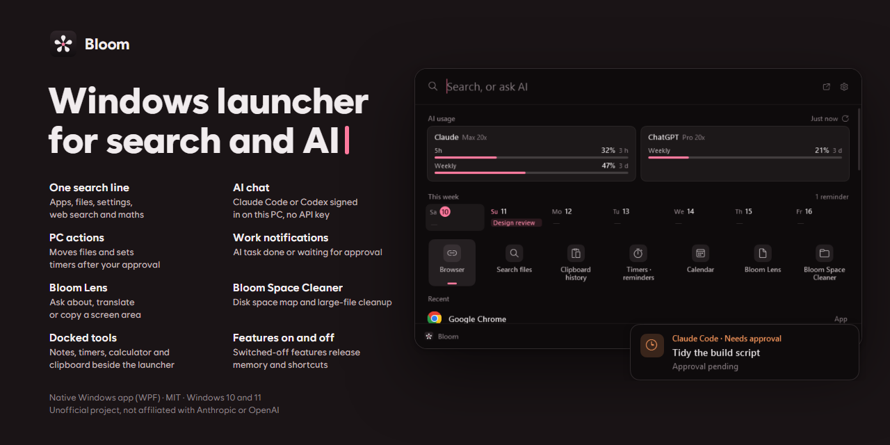
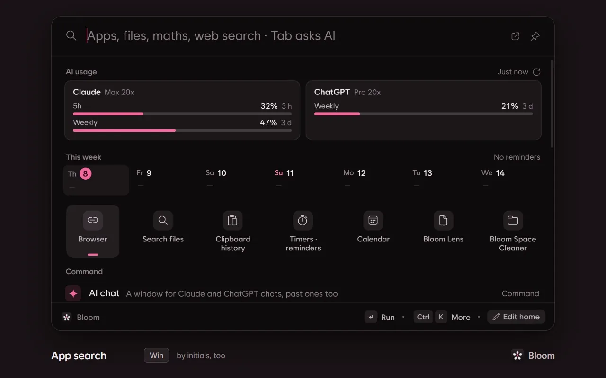
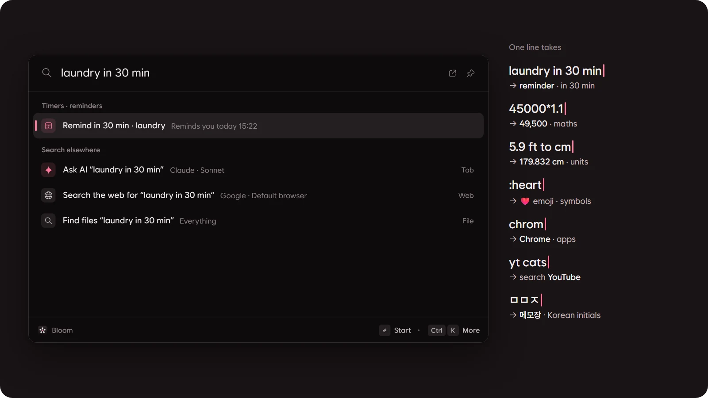
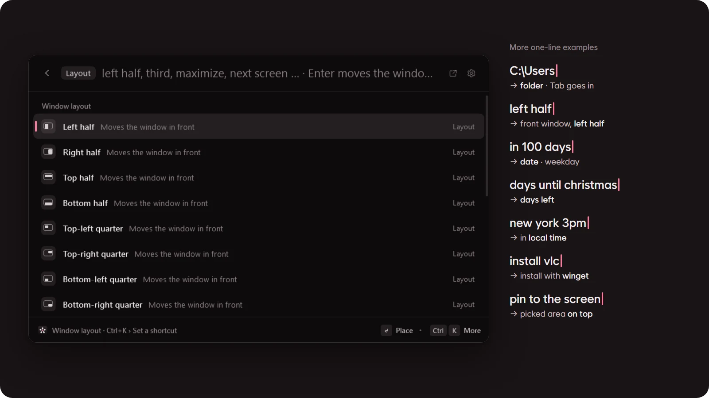
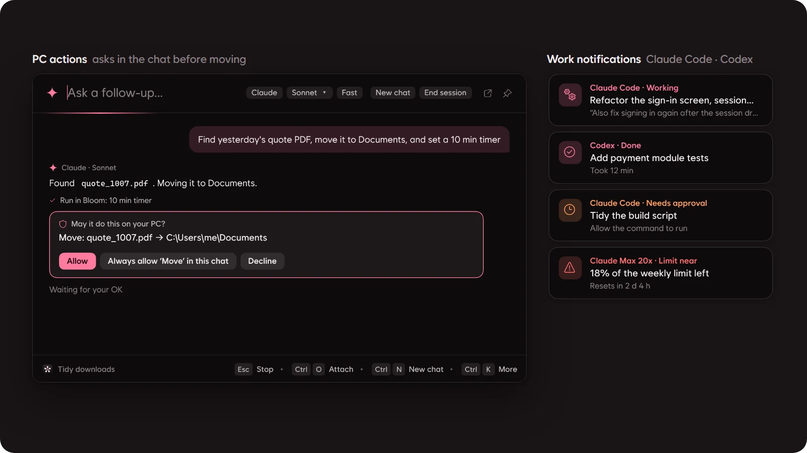
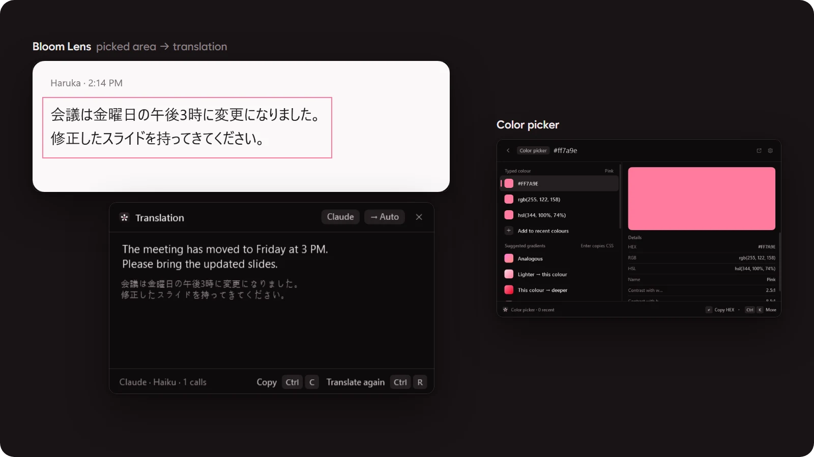
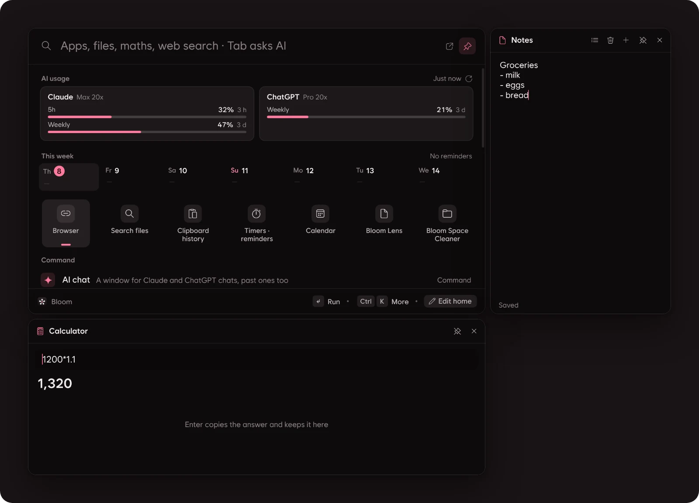
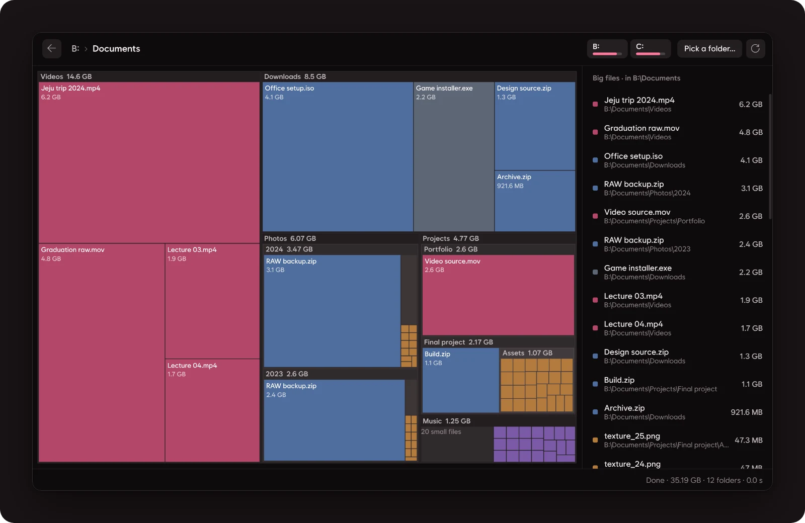
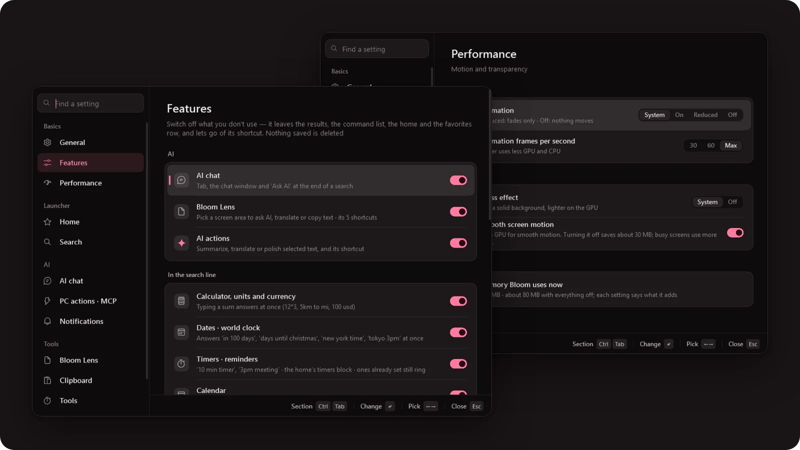

<p align="center"></p>

<p align="center">A light native launcher for Windows: open apps, do maths, find files, chat with AI and translate the screen, all from one search line.</p>

<p align="center">
  <a href="#download">Download</a> · <a href="#features">Features</a> · <a href="#shortcuts">Shortcuts</a> · <a href="#about-the-ai-features">AI &amp; privacy</a> · <a href="README.ko.md">한국어</a>
</p>

<p align="center">
  
</p>

<p align="center"><sub>WPF · .NET 10 · no WebView · about 80 MB with everything off · English / 한국어 / 日本語 / 简体中文 · MIT</sub></p>

- **One line does it.** Apps, files, maths, reminders, emoji and web searches all live in one search line, found from a few letters.
- **The AI you already use.** No API key: ask the Claude Code or Codex you are signed in to on this PC, and hand it tidying files, notes, timers and your calendar.
- **Light, and yours to trim.** A native app with no WebView. Switch off what you don't use and it leaves the menus, the shortcuts and the memory.

## Download

**[Get Bloom for Windows](https://github.com/hyeon1035298/Bloom/releases/latest)** — `BloomLauncher-win-Setup.exe` on the latest release.

- Windows 10/11, 64-bit. If the PC doesn't have the .NET 10 Desktop Runtime, the setup installs it (Windows asks for permission for that part).
- Bloom installs for your account only, into `%LOCALAPPDATA%\BloomLauncher`, with a Start-menu shortcut. Remove it in Windows Settings › Apps; your settings stay in `%APPDATA%\Bloom`.
- Bloom isn't code-signed yet, so SmartScreen may say "Windows protected your PC". Choose **More info › Run anyway**.
- **Updates**: once, a little after it starts, Bloom looks at this repository's latest release. A new version downloads in the background and goes in the next time Bloom starts. Settings › About has **Check for updates** (and **Restart to update** once one is ready) and a switch for the look at start. After an update Bloom shows what changed once (again any time in Settings › About).

## Features

### One search line



You don't need the whole name. Sums are worked out as you type, and times are written the way you'd say them.

- **Apps · settings · commands**: Start-menu apps, Windows settings pages and Bloom commands.
  - A name's initials work (`gc` → Google Chrome).
  - For Korean users it also understands initial consonants (`ㅁㅁㅈ` → 메모장) and words typed with the keyboard left in Korean (`초개ㅡㄷ` → Chrome).
  - An app can be renamed inside Bloom only.
- **Favourites**: keep apps, files, sites and commands in the home's icon row and open them with Ctrl+1…9.
  - Group them in folders.
  - Give them picture icons that match their names, or icons drawn by AI.
- **Maths · units · currencies**: `45000*1.1`, `(1+2)*3`, `5!`, `5.9 ft to cm`, `5km to mi`, `100 usd`
  - Enter on the result copies it.
- **Timers · reminders · calendar**: `timer 5m`, `laundry in 30 min`, `remind me at 3pm to call`
  - Reminders also show on the monthly calendar and in the home's "This week".
  - When one is due, a card comes up with a sound (again in 5 min · dismiss).
- **Web search · site shortcuts**: what you typed goes to your browser as a search (Google · Naver · Bing · DuckDuckGo).
  - A keyword sends it to a site: `yt cats`, `gh bloom`, `map central park`.
  - Make and edit your own site shortcuts, and pick the browser searches and links open in.
- **Files · recent files**
  - With [Everything](https://www.voidtools.com/) installed, find files by name at once, narrow by kind (videos, pictures, documents, folders …) and preview them.
  - Without it, Bloom finds them in Windows' recent files.
- **Window switching**: find an open window by name and switch to it; Ctrl+W closes it.
- **Emoji · symbols**: by English or Korean name, then paste: `:heart`, `arrow`, `celsius`.
- **System**
  - Dark mode, mute sound or microphone, `volume 30`, switch the output device, Wi-Fi · Bluetooth, show hidden files · extensions
  - Sleep, screen off, empty the Recycle Bin, end processes, lock · restart · shut down
- **Ctrl+K** on any result lists everything you can do with it. On a file: rename, move or copy to another folder, Recycle Bin — the way Explorer does it, with the same progress window and name-clash questions.
- What you pick after typing the same letters comes up first next time. A new habit beats an old one, and the settings can clear it.

### Paths, windows, dates and installs



- **Paths**: type `C:\Users`, `D:/work`, `~\Downloads` or `%APPDATA%` and that folder comes first with what's in it. Enter opens it in Explorer; Tab goes into the folder you picked.
- **Window layout**: `left half`, `right third`, `top-left quarter`, `maximize`, `center`, `next screen` move the window in front. Halves meet edge to edge and the taskbar stays clear.
- **Dates · world clock**: `in 100 days`, `days until christmas`, `days since 2026-03-01`, `2026-01-01 ~ 2026-12-25`, `new york time`, `tokyo 3pm`, `3pm in london`
- **Install apps**: `install vlc` looks it up in winget and the Microsoft Store. Enter asks first, then installs it in the background and a card tells you how it went. Ctrl+K installs it in a terminal you can watch.
- **Shortcuts for anything**: Ctrl+K › Set a shortcut gives an app, folder, file, site, command or window layout a global shortcut of its own: just press the keys you want (say Ctrl+Alt+M). They're listed in Settings › Tools.
- **Uninstall apps**: right-click an app (or Ctrl+K) › Uninstall…. Bloom asks once more, then opens that program's own uninstaller; a Store app is removed for your account.
- **Pin to the screen · capture**: Bloom Lens' fifth and sixth choices (see below).
- Each of these can be switched off in Settings › Features.

### AI with your own Claude Code · Codex login



No API key. Answers come from the Claude Code or Codex CLI you have installed and signed in to on this PC.

- **Ask at once**: type in the search line and press **Tab** to ask right there; Shift+Tab starts a new chat. Pick the model and the thinking level.
  - Esc goes back home and the answer keeps going; the search line shows it and Tab takes you back. ■ Stop (or Ctrl+.) stops it.
- **AI chat window** (Ctrl+Alt+C)
  - Continue past chats and keep them in groups (folders).
  - Attach files and pictures (drag and drop · Ctrl+O · Ctrl+V).
  - Open or save the files the AI makes.
  - Chats name themselves per task, like `[◆ Opus • Code ] Fix the login` (model · field · task); the title changes only when a new task starts.
  - Pick several chats and groups and delete them at once: ✓ by the chat search, Ctrl+click, or ⋯ › Select.
  - A chat left alone closes its CLI after 10 minutes to give the memory back; set minutes or hours (or 0 = never) in Settings › AI chat.
- **Copy any part**: drag over an answer, your message or a code block (in the quick chat too) and press Ctrl+C or right-click › Copy.
- **Hand off PC tasks**: "move the quote PDF I got yesterday into Documents", "volume 30", "find last week's videos in Downloads".
  - Anything that changes something is asked about on a card in the chat, every time (Allow · Always in this chat · Decline).
  - What was done stays under the answer as ✓ / ✕.
- **Notes, timers and events stay in Bloom**
  - "Write my shopping list in a note" attaches Bloom's notes beside the chat and writes it there.
  - "A 25 minute timer" and "put a meeting on my calendar tomorrow at 3pm" go into Bloom's timers and calendar, and the timers tool comes up beside the chat to show them.
  - No files are made and no other app is opened for them.
- **Quick AI actions** (Ctrl+Alt+A): in any app, turn the selected text (or the clipboard when nothing is selected) into something else and paste it back.
  - Summarize · translate · fix spelling · polish · shorter · longer · formal · casual · key points as a list · explain simply · draft a reply
  - Or write your own instruction.
- **Usage**: the home shows Claude's and ChatGPT's 5-hour and weekly limits, as used or as left, refreshed every 5 or 10 minutes.
- **Work notifications**: a card in a screen corner and a sound when a Claude Code or Codex task starts, finishes, waits for approval, or nears or regains its usage limit.
  - Pick one of six positions, the size, the sound and which events.
  - None during full-screen games or presentations.

### On the screen — Bloom Lens · color picker



- **Bloom Lens** (Ctrl+Alt+L): drag over an area of the screen, then pick what to do by number.
  - `1` Ask AI: Enter with nothing typed explains the screen.
  - `2` Translate
  - `3` Copy its text (Windows OCR)
  - `4` Translate live: Bloom keeps reading the area and translates it whenever it changes.
  - `5` Pin to the screen: the area stays on top as a picture. Drag it, size it with the wheel, Esc closes it.
  - `6` Capture: the area goes to the clipboard as a picture, ready for Ctrl+V.
  - Translate (Ctrl+Alt+T) and copy text (Ctrl+Alt+O) have shortcuts of their own.
- **Color picker**: take a color from the screen with the magnifier, or paste a color code.
  - See HEX · RGB · HSL and its contrast with white and black text.
  - Get gradients made from the color (copied as CSS).
  - Recent colors are kept.

### Docked tools



- **Ctrl+J** (or the tools button at the top) opens notes, timers, calculator and clipboard history as small windows. Asked again, the menu closes.
- **Put them anywhere.**
  - Move a tool by its head and size it by its edges.
  - Near the launcher, another tool or a screen edge, it snaps in place.
  - Dropped beside the launcher it stays attached right there, at that size: it moves with the launcher and comes and goes with it.
  - Pulled away, it floats on its own. The pin on its head keeps it always on top (off at first).
- **Notes**: several notes, kept as you type. Pin them; deleted ones go to a trash.
  - Type `note buy milk` in the search line to keep a note at once.
  - Notes are searched too.
- **Timers**: set days, hours, minutes and seconds (▲ ▼, the mouse wheel, the arrow keys or digits), write what it is for underneath and press Start or Enter. Left at zero, the line is read as words instead: `10 min`, `3pm meeting`. The time left shows, with 5 more minutes and cancel.
- **Calculator**: the same sums as the search line. Enter copies the answer and keeps it in the list; the bin in its head clears the list.
- **Clipboard history** (Ctrl+Alt+V): the text, images and files you copied. Click one to copy it again; pin the ones you keep.
- **Pin · move · size the launcher**
  - Ctrl+P keeps the launcher on screen (📌 shows while it does).
  - Drag the search line (anywhere past the text) or the bottom bar to move it, to another monitor too; double-click either to put it back in the middle.
  - ⚙ at the end of the search line opens the settings (Ctrl+,).
  - Ctrl+= / Ctrl+- / Ctrl+0 scale Bloom from 80 to 150 % — the launcher, tools, AI chat and settings together.

### Bloom Space Cleaner



A map of where a drive's or folder's space went, every folder and file a block as big as it is.

- Click a block to go inside; pick big files from the list beside it and send them to the Recycle Bin.
- Switch drives or pick a folder to look at.
- Drive roots and the Windows folder are never touched, and the Recycle Bin can bring things back.

### Yours to trim



- **My commands**: run what you do often by a keyword.
  - Scripts: .ps1 · .bat · programs, or one PowerShell line. They run without a window; the result comes as a notice card.
  - Snippets: saved text pasted into the window in front (`{date}` `{time}` `{clipboard}`).
  - Chains: lines for the search line, run in turn (`notepad ; volume 30 ; wait 2 ; yt lofi`).
  - Words after the keyword fill the `{input}` spot (`bk D:\photos`).
  - Script files are added from Ctrl+K › My commands.
- **Home** (Ctrl+E): pick the blocks the empty search line shows (favourites · AI usage · this week · timers · recently used · commands …) and their order.
- **Features on and off**: a feature you don't use (AI chat · Bloom Lens · calculator · timers · color picker · emoji · window switching …) leaves the search results, the command list, the home and the favourites row, and its shortcut is freed. Nothing saved is deleted.
- **Look · performance**
  - Dark, light or system theme, and accent color presets
  - Animations on · reduced · off, how many per second (30 · 60 · max), glass off
  - Draw with the GPU (smooth) or the CPU (about 30 MB less memory; a slow CPU may stutter on busy screens), picked at first start or in Settings › Performance
  - Features that use memory say in the settings how much they add.
- **Language · first start · moving**
  - 한국어 / English / 日本語 / 简体中文 (auto follows Windows); Bloom restarts after a change. Search words, times and units are typed in English or Korean in every language.
  - The first start walks you through how to open Bloom, the home and the AI.
  - Export the settings, favourites, app names and browser shortcuts to one file, and import them on another PC.

## Shortcuts

| Keys | What it does |
| --- | --- |
| `Win` · `Alt+Space` | Open Bloom |
| `Tab` / `Shift+Tab` | Ask AI what's in the search line / in a new chat |
| `Ctrl+K` | Everything you can do with the picked result |
| `Ctrl+1` … `Ctrl+9` | Favourites |
| `Ctrl+J` | Tools (notes · timers · calculator · clipboard) |
| `Ctrl+P` | Pin the launcher |
| `Ctrl+E` | Edit the home |
| `Ctrl+=` · `Ctrl+-` · `Ctrl+0` | Bigger · smaller · 100 % |
| `Esc` | Back → clear the text → close (the quick AI's answer keeps going) |
| `Ctrl+.` | Stop the quick AI's answer |
| `Ctrl+Alt+C` | AI chat window |
| `Ctrl+Alt+A` | Quick AI actions |
| `Ctrl+Alt+L` | Bloom Lens |
| `Ctrl+Alt+T` · `Ctrl+Alt+O` | Translate the screen · copy text from the screen |
| `Ctrl+Alt+V` | Clipboard history |

The global shortcuts can be changed or switched off per feature in the settings: click one and press the keys, Backspace turns it off. Any key works with Ctrl, Alt, Shift or Win; keys that type nothing (F1–F24, PrintScreen, Pause, media keys) work alone too. Window switching, emoji, the color picker, asking AI about the screen, live translation and capture can have one too (off at first).

## About the AI features

Bloom **never takes or stores your sign-in details.** The AI features only run the official CLIs you have already installed and signed in to on this PC.

- Claude: [Claude Code](https://docs.anthropic.com/en/docs/claude-code) CLI (`claude`)
- ChatGPT: [Codex CLI](https://github.com/openai/codex) (`codex`)

Usage and terms are those of your own accounts. Without the CLIs only the AI features are off; everything else works as usual.

**AI acting on the PC** (Claude · ChatGPT, Settings › PC actions · MCP)

- Bloom offers one tool (`pc`) through an MCP server that only opens on this PC (`Bloom.exe --mcp`, a named pipe only this Windows user can open).
- What it may do comes in five groups, each switched on or off in the settings.
  - **Look up**: apps · files (Everything) · recent files · windows · timers and events · notes · my commands. Runs at once, without asking.
  - **Open · run**: open apps, files and sites, run a search-line line (`volume 30`, `yt lofi`), run my commands.
  - **Notes · timers · calendar**: write in Bloom's notes (they show beside the chat), start timers, put events on the calendar.
  - **Tidy files**: rename · move · copy · Recycle Bin.
  - **Clipboard**: read · write.
- Everything but look-ups is asked about every time with **Allow / Always in this chat / Decline buttons in the chat** (Claude Code's `--permission-prompt-tool stdio`). What was done stays under the answer as ✓ / ✕.
- Other MCP servers already set up on this PC show on the same page, one switch per server (off by default).
  - They are found in the settings of Claude Code · Claude Desktop · Cursor · VS Code · Windsurf · Codex, and in the `.mcp.json` of projects opened with Claude Code.
  - Their tools are asked about with the same card each time.
  - For ChatGPT, Bloom puts a relay in front of the server (`Bloom.exe --mcp-proxy`) to ask.
  - Server settings are never copied into Bloom; they are read from their own files each time.
- The tool definition is cut down to one tool: about +500 input tokens per request against no tools. That is +400 as measured before the notes · timers · calendar group, plus that group's share of the description's length. Less with groups switched off. Your other MCP servers are not loaded (`--strict-mcp-config`).
- ChatGPT (Codex) chats use the same tool.
  - Codex can't ask by itself in exec mode, so Bloom's MCP server shows the same card right before acting and waits for the answer.
  - The server is attached per chat run with `-c mcp_servers.bloom…` only.
  - Codex loads MCP tool descriptions only when needed, so a one-line note of the tool's name and actions goes with each request (about +250 tokens, worked out the same way).

AI usage comes from `claude -p /usage` (no model call) and the limit lookup of `codex app-server`. Work notifications only read Claude Code's and Codex's own logs on this PC (`~/.claude/sessions`, `~/.codex/sessions`) and send them nowhere.
The update look asks GitHub's API (`api.github.com`) for this repository's latest release and downloads it from GitHub when there is one; nothing from your settings, files or chats goes with it. Switch it off in Settings › About.
Only what you send yourself reaches the AI — your question, attached files, the screen area picked with Bloom Lens, the text to translate — and what the PC tool returns.
Claude can read and write files only inside that chat's folder (`%LOCALAPPDATA%\Bloom\ai\files\<chat>`). ChatGPT (Codex) doesn't handle files itself, so text attachments go in the message and files it makes are taken out of the answer and saved.

Bloom is an unofficial personal project, not affiliated with Anthropic, OpenAI, voidtools or Raycast.

## Install · build

To use Bloom, take the setup file from [Download](#download). To build it yourself you need Windows 10/11 and the [.NET 10 SDK](https://dotnet.microsoft.com/download).

```powershell
dotnet build src\Bloom\Bloom.csproj -c Release
# or make an installed copy
powershell -File tools\package.ps1   # → dist\app
powershell -File tools\install.ps1   # → %LOCALAPPDATA%\Programs\Bloom, Start-menu shortcut
```

Data lives in `%APPDATA%\Bloom` and `%LOCALAPPDATA%\Bloom`.
For development, `Bloom.exe --data <folder>` uses another data folder (`--lang ko|en` fixes the language).
A copy made with `tools\install.ps1` doesn't update itself; only the setup's does.

**A release**: raise `<Version>` in `src/Bloom/Bloom.csproj`, write what changed under `## <Version>` in `CHANGELOG.md` (that becomes the release's text; without it the commit list is used), push, then run **Actions › Release › Run workflow** on GitHub. It runs the tests, builds, packs the setup file and the update packages with [Velopack](https://velopack.io) and publishes them as `v<Version>`; installed copies find it at their next start.

## Code structure

<details>
<summary>Folders · conventions · tests and lint</summary>

Under `src/Bloom`, one folder is one feature. Big classes are split into `partial` files by topic.

| Folder | What's in it |
| --- | --- |
| `App/` | `Host` (wires the whole app: start · shortcuts · commands · Lens · timers/colors · running my commands · file actions), work notifications (`Notices`), updates from GitHub Releases (`Updates`, Velopack), the MCP server (`Mcp/` — relay · server · the `pc` tool), run options, tray, the Win key hook |
| `App/Engine/` | Making what the search line shows — root search, home blocks, item conversion, per view (files · clipboard · calendar · timers · colors …) |
| `App/Qa/` | Off-screen capture QA (`--capture <folder> --qa-set v15 --data <folder> --lang en`) |
| `Core/` | What is saved (settings · favourites · usage · learning per typed text · timers · notes · colors) and JSON storage, Korean search, matching, the interface language (`Lang` — `Tr("한국어", "English")`) |
| `Search/` | App list, calculator (sums · units · currencies), Everything, open windows, recent files, emoji · symbols (`Assets/symbols.tsv`), system items, my commands (`UserCommands`), result models |
| `Ai/` | Claude Code / Codex CLI sessions with chats · groups (`Chats`), one-shot asks (`OneShot`), translation, quick AI actions, AI icons, usage (`AiUsage`), reading work logs (`ClaudeWatch` · `CodexWatch`) |
| `Ocr/` | Picking a screen area, Windows OCR, the translation window, picking colors |
| `Clip/`, `Space/`, `Browser/` | Clipboard history, the disk space map, handing off to the browser |
| `Native/` | Win32 calls (System32 DLLs only), WinRT calls (`WinRt`), system toggles (`SystemControl` — sound · wireless · dark mode …), Explorer-style file operations (`ShellFiles`) |
| `Ui/Tools/` | Tool windows: free placement · attaching · magnetic snapping · sizing (`ToolDock`), the window frame (`ToolWindow`), notes · timers · calculator · clipboard |
| `Ui/` | The launcher window (`Launcher/` — every view's chips · hints · results in one place, `Launcher.ViewSpecs.cs`), the AI chat window (`Chat/`), the settings window (`Settings/`), notice cards, shared controls (`Controls/` — continuous-curvature corners `SmoothBorder`, `Dropdown`, `PopupMenu`), theme (`Theme/` — animation settings in `Motion`) |
| `tests/Bloom.Tests` | Automated tests (calculator · time reading · dates and world clock · typed paths · winget's table · shortcuts · matching · learning · emoji · language · AI prompts · the MCP tool · usage reading · work logs · my commands) — a console run without a test framework |

Conventions: a new feature splits into `Engine.<feature>.cs` (results) + one view line in `Launcher.ViewSpecs.cs` + `Core/<feature>.cs` (storage) when needed.
Every piece of text on screen is written as `Tr("한국어", "English")`. Japanese and Simplified Chinese come from `src/Bloom/Assets/Lang/ja.tsv` and `zh.tsv`, keyed by the English text (`{0}` for each hole of an interpolated one); `python tools/lang.py check` lists what they miss, `todo ja` the texts still to translate. Search keywords and parser data keep Korean and English.
QA and development runs always use `--data <temporary folder>`, apart from the real data.

```powershell
# tests (exit code = failures)
dotnet run --project tests\Bloom.Tests
# lint (analyzers + formatting) — zero warnings
dotnet build src\Bloom\Bloom.csproj -c Debug --no-incremental -p:AnalysisLevel=latest-recommended -p:EnforceCodeStyleInBuild=true
dotnet build tests\Bloom.Tests\Bloom.Tests.csproj -c Debug --no-incremental -p:AnalysisLevel=latest-recommended -p:EnforceCodeStyleInBuild=true
dotnet format whitespace src\Bloom\Bloom.csproj --verify-no-changes
dotnet format whitespace tests\Bloom.Tests\Bloom.Tests.csproj --verify-no-changes
```

</details>

## Optional

Nothing here is required. Without them, the related blocks and settings don't show.

- **Everything**: finding files.
- **Claude Code CLI · Codex CLI**: AI chat · Lens · translation · quick actions · usage · work notifications.

## License

MIT — [LICENSE](LICENSE).
Exchange rates: [Rates By Exchange Rate API](https://www.exchangerate-api.com).
